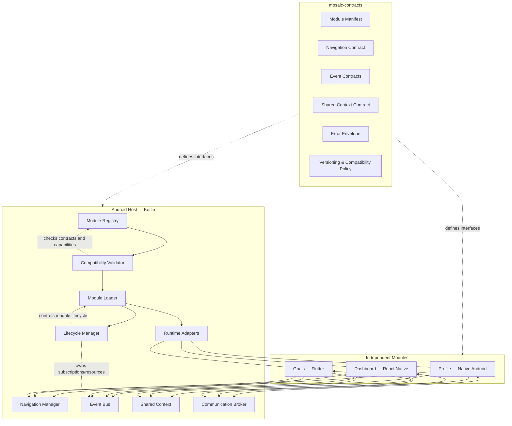
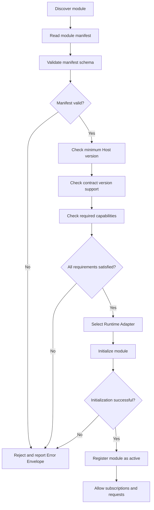
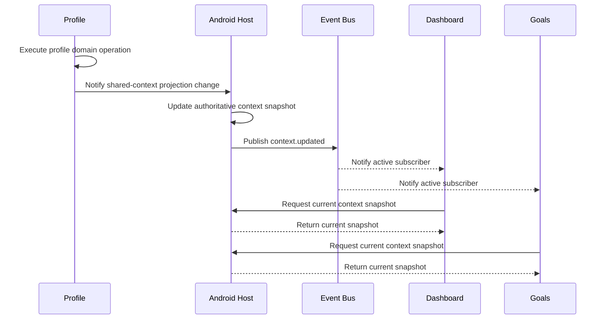
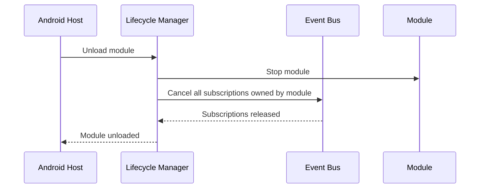

# Mosaic Architecture Diagram

This document provides a high-level view of the Mosaic components and their integration boundaries.

## 1. Component Diagram

## 2. Module Loading Flow

## 3. Shared Context Update Flow

`context.updated` is a proposed event and must receive a formal schema before implementation.

## 4. Module Unload and Subscription Cleanup

## 5. Diagram Notes

- The Host owns global infrastructure and cross-module routing.
- Modules own their internal UI, business rules, state, and domain persistence.
- Modules do not call one another's internal implementations.
- All cross-module communication uses explicit contracts mediated by the Host.
- The Registry, Validator, Loader, and Lifecycle Manager are separate responsibilities.
- The diagram is conceptual; it does not prescribe concrete classes, threads, processes, or runtime embedding APIs.
